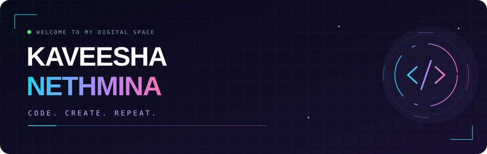
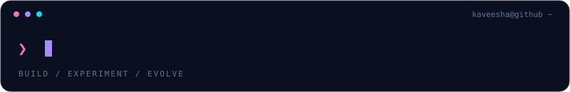
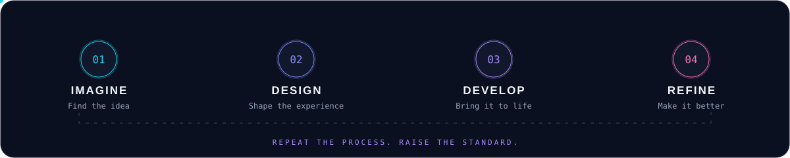

 

 
 

### `01` / THE PERSON BEHIND THE COMMITS

**Hey, I'm Kaveesha — a web developer from Sri Lanka.** 
I work across the interface and the backend, bringing together 
**web, mobile, backend, databases, games, and creative tools.**

 

### `02` / MY TECH UNIVERSE

The technologies I work with — from the first HTML element to the server.

 
 

#### FRONTEND & WEB

**HTML · CSS · JavaScript · React · Next.js · Tailwind CSS · Bootstrap**

 

#### BACKEND & BUILD TOOLS

**PHP · Java · Apache Maven**

 

#### DATABASES & CLOUD

**Firebase · MySQL · PostgreSQL · Cloudflare**

 

#### MOBILE & GAME DEVELOPMENT

**Android · React Native · Unity**

 

#### CREATIVE TOOLS & AI

**Canva · AI tools & experiments**

 
 

### `03` / FROM PIXELS TO LOGIC

**◈ Interfaces with character** 
HTML and CSS for structure and detail. React and Next.js for component-based interfaces. Tailwind CSS for styling across screen sizes.

**⌘ Behaviour behind the interface** 
JavaScript for interaction. PHP and Java for backend development. MySQL, PostgreSQL, and Firebase for data, with Apache Maven in my Java workflow.

**✦ Beyond the browser** 
Android and React Native for mobile development, Unity for games, Cloudflare for web infrastructure, and Canva and AI tools for creative work.

**✦ The details that make it feel right** 
Responsive layouts, clear navigation, consistent spacing, and motion that gives an interface personality.

 

### `04` / THE BUILD LOOP

 

### `05` / EXPLORE MY WORLD

 

**Code with purpose. Design with personality.**

Web · Mobile · Backend · Databases · Cloud · Games · Design · AI

 
 

