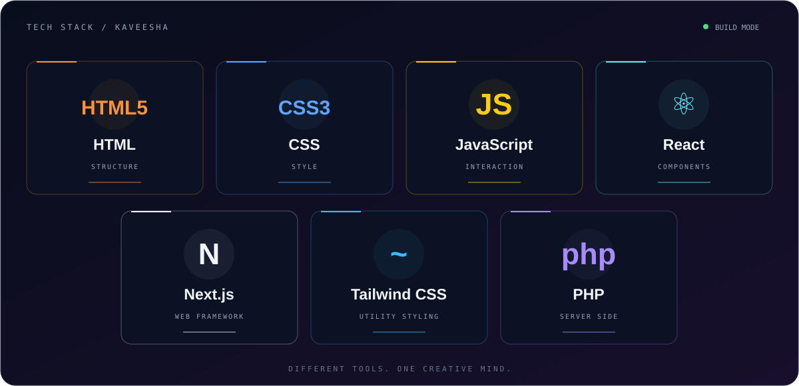

<div align="center">


<br/>


[](https://github.com/Kaveesha-Nethmina-143)
[](https://astrea.lk/)
[](https://github.com/Kaveesha-Nethmina-143?tab=repositories)

<br/>
<br/>

### `01` / THE PERSON BEHIND THE COMMITS

**Hey, I'm Kaveesha — a web developer from Sri Lanka.**<br/>
I work across the interface and the backend, bringing together<br/>
**PHP, JavaScript, React, Next.js, and carefully crafted CSS.**

</div>

```typescript
const developer = {
  name: "Kaveesha Nethmina",
  basedIn: "Sri Lanka 🇱🇰",
  connectedWith: "Astrea Solutions",
  frontend: ["HTML", "CSS", "JavaScript", "React", "Next.js"],
  styling: ["Tailwind CSS", "Responsive layouts"],
  backend: ["PHP"],
  mindset: "Build → experiment → improve → repeat",
};
```

<div align="center">

<br/>

### `02` / MY TECH UNIVERSE

<sub>The technologies I work with — from the first HTML element to the server.</sub>

<br/>
<br/>



[](https://developer.mozilla.org/en-US/docs/Web/HTML)
[](https://developer.mozilla.org/en-US/docs/Web/CSS)
[](https://developer.mozilla.org/en-US/docs/Web/JavaScript)
[](https://react.dev/)
[](https://nextjs.org/)
[](https://tailwindcss.com/)
[](https://www.php.net/)

<br/>
<br/>

### `03` / FROM PIXELS TO LOGIC

</div>

**◈ Interfaces with character**<br/>
HTML and CSS for structure and detail. React and Next.js for component-based interfaces. Tailwind CSS for styling across screen sizes.

**⌘ Behaviour behind the interface**<br/>
JavaScript for interaction and application logic. PHP for the server side of the experience.

**✦ The details that make it feel right**<br/>
Responsive layouts, clear navigation, consistent spacing, and motion that gives an interface personality.

<div align="center">

<br/>

### `04` / THE BUILD LOOP


<br/>

### `05` / EXPLORE MY WORLD

[](https://github.com/Kaveesha-Nethmina-143?tab=repositories)
[](https://github.com/Kaveesha-Nethmina-143?tab=overview)
[](https://astrea.lk/)

<br/>

**Code with purpose. Design with personality.**

<sub>PHP · HTML · CSS · JavaScript · React · Next.js · Tailwind CSS</sub>

<br/>
<br/>

</div>
