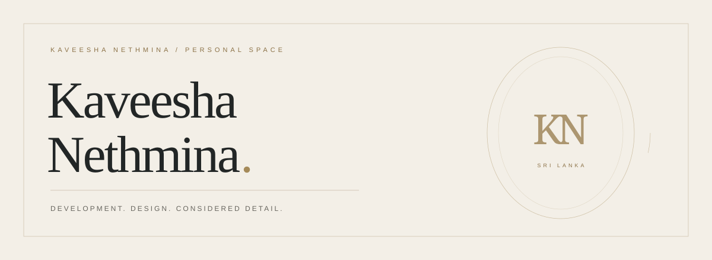
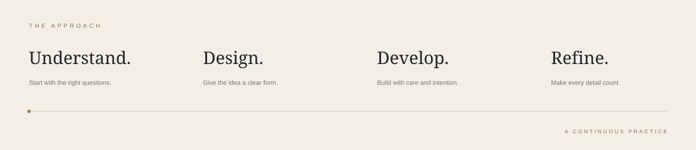
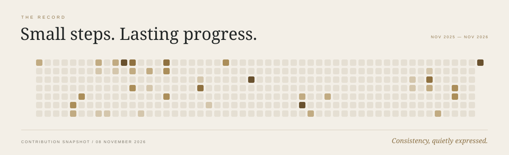

 

S R I &nbsp; L A N K A &nbsp; / &nbsp; A S T R E A &nbsp; S O L U T I O N S

 
 

### Thoughtful development. Considered design.

I'm **Kaveesha Nethmina**, a developer with an interest in the relationship 
between useful technology and a well-crafted experience.

My practice spans **web, mobile, backend development, databases, 
game development, and creative tools**.

 

[Explore my work](https://github.com/Kaveesha-Nethmina-143?tab=repositories) &nbsp; · &nbsp; [Astrea Solutions](https://astrea.lk/) &nbsp; · &nbsp; [Contribution history](https://github.com/Kaveesha-Nethmina-143?tab=overview)

 
 

 
 

### A balance of form and function.

**For the web** — HTML, CSS, JavaScript, React, Next.js, Tailwind CSS, and Bootstrap. Structure, interaction, and responsive interfaces.

**Behind the experience** — PHP, Java, and Apache Maven. MySQL, PostgreSQL, Firebase, and Cloudflare for data, services, and infrastructure.

**Beyond the browser** — Android, React Native, and Unity. Canva and AI tools support the creative side of the process.

 

 
 

Calendar snapshot: 8 November 2026 · [View live history](https://github.com/Kaveesha-Nethmina-143?tab=overview)

 
 

*Built with care. Refined with intention.*

KAVEESHA NETHMINA &nbsp; / &nbsp; DEVELOPMENT &amp; DESIGN

 

